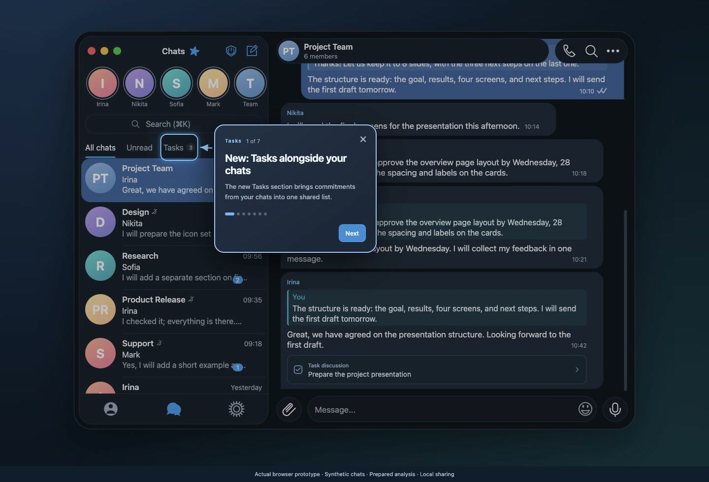

# Telegram AI Tasks

**Keep the conversation with the task.**

An interactive proposal for turning commitments in Telegram chats into tasks, with the discussion that explains them kept close at hand.

[Try the demo](https://tasks.rifeygold.com/) · [Desktop video · 81 s](media/desktop.mp4) · [iPhone video · 81 s](media/iphone.mp4)



The featured recordings show the clear interface first, then the hint and arrow, followed by 25% background dimming. The dimming fades out before the hint disappears. These fades are a recording treatment using actual prototype UI captures.

[Earlier video variants](media/alternatives/README.md) include clean walkthroughs, fixed guide overlays and the short transition preview.

## Explore

- Select chats and review suggested tasks.
- Manage assignees, due dates and statuses in one task list.
- Read the relevant discussion inside a task and jump to the exact source message.
- Create a task from a message, then try sharing it with its assignee.

The interface includes desktop and iPhone layouts, English and Russian, and a guided tour. English chapter captions are available for [desktop](media/desktop.en.srt) and [iPhone](media/iphone.en.srt). The [desktop](media/desktop.storyboard.json) and [iPhone](media/iphone.storyboard.json) storyboards document the recording sequence and timing.

## Run locally

Clone the `telegram-ai-tasks` repository and change into its root directory. With Python 3 installed, run:

```sh
python3 -m http.server 8000 --bind 127.0.0.1 --directory src
```

Open [localhost:8000](http://localhost:8000/). The app uses plain HTML, CSS and JavaScript and needs no build step.

## Check the code

With Node.js 24 or later:

```sh
npm ci --ignore-scripts
npm run check
npm test
```

## Source map

| Files | Purpose |
| --- | --- |
| `src/index.html` | App structure and entry point |
| `src/prototype.js`, `src/prototype.css`, `src/task-share.css` | Tasks, chats, source navigation and sharing flow |
| `src/demo-data.js` | Synthetic conversations and prepared task suggestions |
| `src/i18n.js`, `src/interface-i18n.js`, `src/demo-i18n.js` | Language selection, interface text and demo translations |
| `src/preview.js`, `src/preview.css` | Device layouts and guided tour |
| `test/` | Interaction and regression tests |
| `src/assets/`, `media/` | Local artwork, screenshots, recordings and captions |

## Prototype scope

This standalone browser prototype uses synthetic chats and prepared analysis results. Sharing adds a message within the demo; it does not send anything through Telegram. Tasks, edits and simulated messages are held in memory and reset on reload; language and device preferences can be saved locally. No Telegram account is connected.

Telegram AI Tasks is an independent concept, not an official Telegram project or a native iOS app.

See [CONTRIBUTING.md](CONTRIBUTING.md) for development guidance and [submission/](submission/README.md) for the prepared Telegram Designers message.

## License

Licensed under [MIT](LICENSE). External dependencies retain their own licenses and copyright notices.
